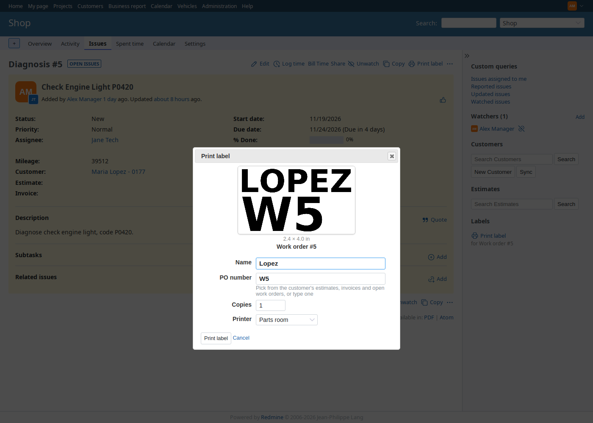
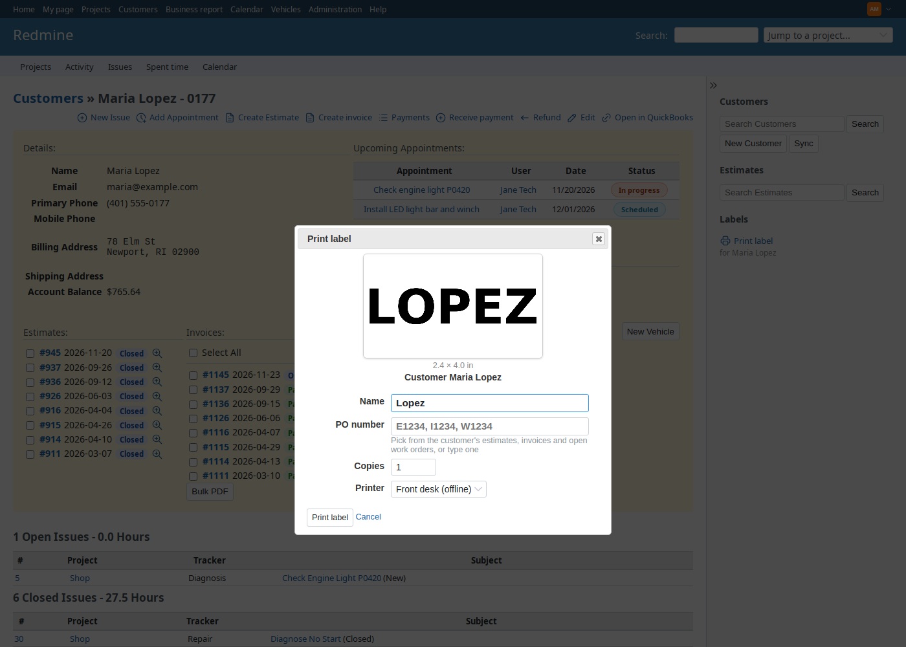
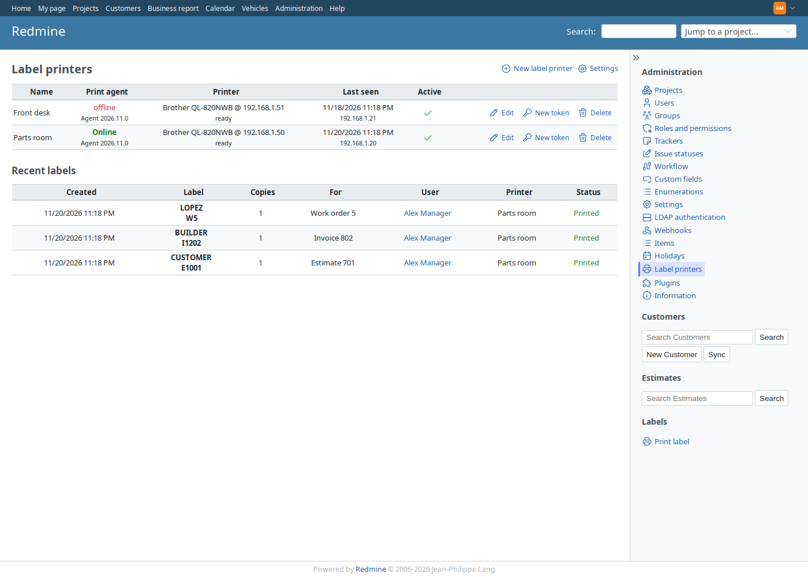
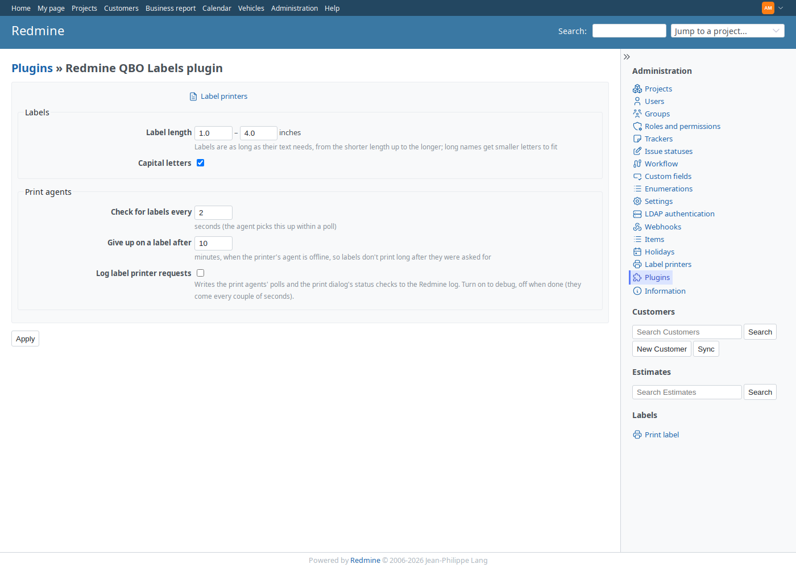

# Redmine QBO Labels

Prints part labels on a Brother QL label printer from Redmine: the customer's last name and the PO number parts are ordered with, in big bold letters that can be read from across the shop.

```
┌──────────────────────┐
│ SMITH                │
│ E1234                │
└──────────────────────┘
```

* **Where**: **Print label** in the top-right actions of an issue, an estimate or an invoice ([redmine_qbo](https://github.com/rickbarrette/redmine_qbo)), and in the sidebar's **Labels** section on every page. The sidebar's fills the label in from the page: a customer (their name), an estimate, an invoice, an appointment ([redmine_qbo_calendar](https://github.com/rickbarrette/redmine_qbo_calendar): its customer and estimate) or a work order; anywhere else it's a blank label to type.
* **What**: the customer's last name (their family name in QuickBooks; a business's whole name) and the PO number: **E** + estimate number, **I** + invoice number, **W** + work order (issue) number. When there's a customer, the PO number field offers their latest estimates, invoices and open work orders to pick from. Both lines can be changed before printing, with a preview of the label as it will print, and up to 10 copies.
* **Size**: labels run along a 62mm (2.4in) continuous roll (e.g. DK-2205) and are only as long as their text needs, up to 4in (both lengths can be changed). Each line gets the biggest letters that fit; a long name gets smaller letters, and the PO number stays big.
* **From anywhere**: Redmine never talks to the printer. A small **print agent** on the printer's network ([redmine_qbo_label_agent](https://github.com/rickbarrette/redmine_qbo_label_agent)) asks Redmine for labels every 2 seconds and prints them, so labels print from a phone or from home, without knowing the printer's address. The agent finds the printer on its network by itself.

The print dialog follows the label until it's printed, or says why it wasn't (no labels in the printer, cover open, printer not found). A label the agent doesn't pick up within 10 minutes (it's offline) is dropped, so it doesn't print hours later.

## Requirements

* Redmine 7
* redmine_qbo 2026.11.0 or later (2026.11.19 or later for **Print label** on invoices)
* A Brother QL printer on the network (made for the QL-820NWB) and a computer on the same network that runs Docker, for the print agent

## Screenshots

All names and figures are made up.

<table>
<tr><td width="50%"><br><sub>Print label on a work order, with a preview of the label</sub></td><td width="50%"><br><sub>Print label from the sidebar on a customer's page</sub></td></tr>
<tr><td width="50%"><br><sub>Label printers and their print agents, with recent labels</sub></td><td width="50%"><br><sub>Label and print agent settings</sub></td></tr>
</table>

## Installation

```
cd /path/to/redmine/plugins
git clone https://github.com/rickbarrette/redmine_qbo_labels.git
cd ..
bundle exec rake redmine:plugins:migrate
```

Restart Redmine, then:

1. **Administration » Label printers » New label printer**: give it a name (e.g. *Parts room*). The next page shows the print agent's token, once, and a Docker Compose file with it filled in.
2. Run the print agent on a computer on the printer's network with that file (see the agent's README). Within a few seconds the printer shows as **Online** on the Label printers page, with the printer the agent found.
3. **Administration » Roles and permissions**: give the roles that print labels **Print labels**. Estimates and invoices also need redmine_qbo's **View customers** (or **Write estimates** / **Write invoices**); issues need to be visible to the user.

With more than one printer, the print dialog asks which one.

## Settings

**Administration » Plugins » Redmine QBO Labels plugin » Configure**:

* **Label length**: the shortest and longest label, in inches (default 1 to 4).
* **Capital letters**: print the lines in capitals (default on).
* **Check for labels every**: how often the agents ask Redmine for labels (default 2 seconds; they pick up a change within a poll).
* **Give up on a label after**: how long a label waits for an offline agent (default 10 minutes).
* **Log label printer requests**: the agents' polls and the print dialog's status checks are left out of the Redmine log, since they come every couple of seconds. Turn this on to see them (and what each poll handed out) while debugging, and off when done. Warnings (such as an agent with a wrong token) and errors are always logged.

## How it works

* `LabelJob`: a label waiting for its printer (*queued*), taken by the agent (*printing*), then *printed*, *failed* (with the printer's error) or *not printed* (expired). Labels are kept 30 days; the latest 50 are on the Label printers page.
* `LabelPrinter`: a printer and its agent's token (only a SHA-256 digest is stored), and what the agent last said about itself and the printer.
* The agent's API (`LabelAgentController`), with the token as `Authorization: Bearer <token>`:
  * `POST /label_agent/poll` `{ "agent": { "version", "printer_model", "printer_address", "printer_status" } }` (agent optional) returns `{ "job": { "id", "lines", "copies", "min_length_mm", "max_length_mm" } | null, "poll_seconds" }`
  * `POST /label_agent/jobs/:id/result` `{ "status": "printed" | "failed", "error": "..." }`
* The label is drawn by the agent; the print dialog draws its preview the same way, with the same font (`assets/javascripts/qbo_labels.js` and the agent's `label_agent/label.py`; keep them in step).

The label font is DejaVu Sans Bold, cut down to Latin letters (see `assets/fonts/LICENSE`).

## Hooks

Hook|Context|Use
---|---|---
`:view_qbo_estimate_contextual`, `:view_qbo_invoice_contextual` (redmine_qbo)|estimate/invoice id|**Print label** on estimates and invoices
`:view_issues_show_details_bottom`|issue|**Print label** on issues (moved into the issue's actions by script, as Redmine has no hook there)
`:view_layouts_base_sidebar`|controller|The sidebar's **Labels** section, filled in from the page's customer, estimate, invoice, appointment or work order

## Tests

```
bundle exec rake redmine:plugins:test NAME=redmine_qbo_labels
```

The tests need redmine_qbo installed, and so a MySQL database.

## License

MIT, see LICENSE.
